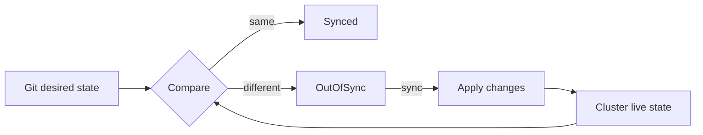
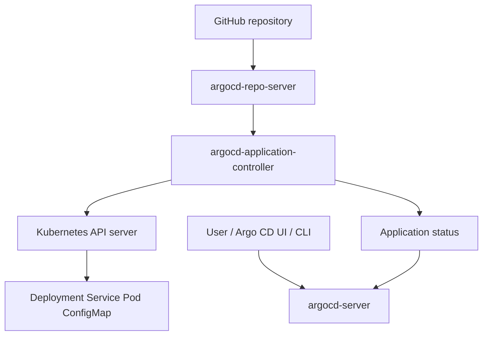
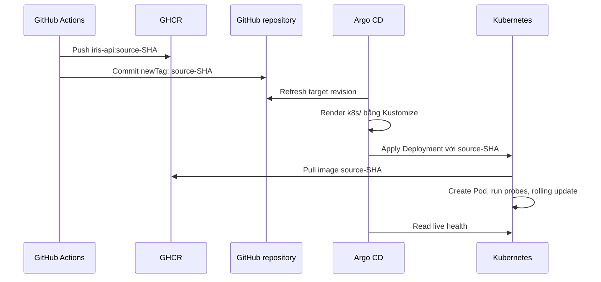

# Argo CD từ con số 0 cho project Iris MLOps

Tài liệu này giả định bạn đã biết sơ bộ Docker và Kubernetes nhưng chưa từng dùng Argo CD.

## 1. Argo CD là gì?

Argo CD là một công cụ **Continuous Delivery theo mô hình GitOps dành cho Kubernetes**.

Ý tưởng cốt lõi:

> Git mô tả cluster nên trông như thế nào; Argo CD liên tục làm cho cluster tiến về trạng thái đó.

Ví dụ, Git ghi:

```yaml
image: ghcr.io/haixon231/iris-api:d264d9f...
replicas: 1
```

nhưng cluster đang chạy:

```text
image: iris-api:1.0
replicas: 3
```

Argo CD nhận ra sự khác nhau và, nếu bật auto sync, cập nhật cluster để khớp Git.

## 2. Argo CD không làm gì?

Argo CD không thay thế toàn bộ CI/CD:

- Không chạy `pytest` cho project này.
- Không build Docker image.
- Không push image lên GHCR.
- Không train model MLflow.
- Không tự biết image `latest` đã thay đổi nếu manifest Git không đổi.

Các việc trên thuộc CI hoặc pipeline phát hành. Argo CD bắt đầu làm việc khi đã có manifest Kubernetes mong muốn trong Git.

## 3. Mô hình “desired state” và “live state”

Đây là hai khái niệm quan trọng nhất.

### Desired/target state

Trạng thái mong muốn được lưu trong Git, cụ thể ở project này là thư mục `k8s/`:

```text
k8s/
├── namespace.yaml
├── mlflow.yaml
├── api-config.yaml
├── api.yaml
└── kustomization.yaml
```

### Live state

Trạng thái đang tồn tại trong cluster:

```bash
kubectl get all -n mlops-demo
```

### Reconciliation — quá trình hòa giải



Argo CD không chỉ chạy một lần. Controller lặp lại vòng so sánh này liên tục. Đây là tư duy controller/operator phổ biến trong Kubernetes.

## 4. Vì sao cần Argo CD nếu đã có `kubectl apply`?

Bạn hoàn toàn có thể chạy:

```bash
kubectl apply -k k8s
```

Nhưng cách thủ công có các hạn chế:

- Máy của người deploy cần kubeconfig và quyền vào cluster.
- Khó biết ai đã deploy phiên bản nào.
- Thay đổi trực tiếp trong cluster có thể không tồn tại trong Git.
- Phải tự theo dõi drift giữa Git và cluster.
- Pipeline CI cần giữ cluster credential nếu nó trực tiếp deploy.

Với Argo CD:

- CI chỉ cần cập nhật Git.
- Argo CD chạy bên trong Kubernetes và có quyền đồng bộ cluster.
- Git history trở thành lịch sử deploy.
- Có UI hiển thị quan hệ Application → Deployment → ReplicaSet → Pod.
- Có thể tự sửa drift bằng `selfHeal`.

## 5. Kiến trúc đơn giản của Argo CD



Các Pod thường thấy trong namespace `argocd`:

| Component | Vai trò |
|---|---|
| `argocd-server` | API và Web UI; xác thực, RBAC, hiển thị trạng thái |
| `argocd-repo-server` | Clone/cache Git repo và render manifest bằng Kustomize/Helm/plain YAML |
| `argocd-application-controller` | So sánh desired state với live state và thực hiện sync |
| `argocd-redis` | Cache dữ liệu nội bộ |
| `argocd-dex-server` | Tích hợp đăng nhập SSO/OIDC |
| `argocd-notifications-controller` | Gửi notification khi được cấu hình |
| `argocd-applicationset-controller` | Tạo nhiều Application từ template; project hiện tại chưa cần dùng |

Không nên hiểu rằng mọi component đều trực tiếp sửa Deployment. Thành phần trung tâm cho reconciliation là `application-controller`.

## 6. CRD và resource `Application`

Kubernetes mặc định biết các kind như:

```text
Pod
Service
Deployment
ConfigMap
```

Argo CD cài thêm CustomResourceDefinition, trong đó có:

```text
applications.argoproj.io
appprojects.argoproj.io
applicationsets.argoproj.io
```

Nhờ CRD `applications.argoproj.io`, Kubernetes hiểu manifest:

```yaml
apiVersion: argoproj.io/v1alpha1
kind: Application
```

`Application` là object khai báo:

1. Lấy desired state từ đâu.
2. Đưa nó tới cluster/namespace nào.
3. Đồng bộ tự động hay thủ công.

## 7. Đọc `argocd/application.yaml` của project

### 7.1 Danh tính của Application

```yaml
metadata:
  name: mlops-demo
  namespace: argocd
```

- Tên Application trong Argo CD là `mlops-demo`.
- Object `Application` nằm trong namespace `argocd`, nơi Argo CD được cài.
- Các workload mà nó quản lý lại nằm trong namespace `mlops-demo`.

Hai namespace này có mục đích khác nhau.

### 7.2 Project của Argo CD

```yaml
spec:
  project: default
```

`AppProject` là ranh giới quyền và phạm vi trong Argo CD. Lab đang dùng project mặc định. Trong hệ thống lớn, AppProject giới hạn repository, cluster và namespace mà một nhóm được deploy.

### 7.3 Nguồn Git

```yaml
source:
  repoURL: https://github.com/HaiXon231/MLOps-lab.git
  targetRevision: main
  path: k8s
```

Ý nghĩa:

- Clone repository `MLOps-lab`.
- Theo dõi branch `main`.
- Chỉ render nội dung dưới thư mục `k8s`.

Vì thư mục đó có `kustomization.yaml`, Argo CD tự nhận biết và chạy Kustomize.

### 7.4 Đích triển khai

```yaml
destination:
  server: https://kubernetes.default.svc
  namespace: mlops-demo
```

`https://kubernetes.default.svc` là Kubernetes API của chính cluster nơi Argo CD đang chạy. Đây không phải URL từ laptop và cũng không phải địa chỉ GHCR.

Namespace đích là `mlops-demo`.

### 7.5 Đồng bộ tự động

```yaml
syncPolicy:
  automated:
    prune: true
    selfHeal: true
```

#### `automated`

Khi Git thay đổi và Application thành `OutOfSync`, Argo CD tự sync mà không cần bấm nút.

#### `prune: true`

Nếu một resource được xóa khỏi Git, Argo CD có thể xóa resource tương ứng khỏi cluster.

Ví dụ: xóa `Service` khỏi `k8s/api.yaml`, commit và push có thể dẫn đến Service trong cluster bị xóa. Đây là tính năng hữu ích nhưng cần cẩn thận ở production.

#### `selfHeal: true`

Nếu ai đó sửa trực tiếp live resource:

```bash
kubectl scale deployment iris-api -n mlops-demo --replicas=5
```

trong khi Git vẫn ghi `replicas: 1`, Argo CD có thể đưa cluster trở về `1`.

Do đó khi dùng GitOps, tránh sửa resource do Argo CD quản lý bằng `kubectl edit` như một giải pháp lâu dài.

### 7.6 Tạo namespace

```yaml
syncOptions:
  - CreateNamespace=true
```

Argo CD được phép tạo namespace đích nếu nó chưa tồn tại. Project đồng thời có `namespace.yaml`; trong lab điều này không gây vấn đề, nhưng về thiết kế nên hiểu rõ ai là chủ sở hữu namespace.

## 8. Argo CD phối hợp với Kustomize

Manifest Deployment chỉ ghi:

```yaml
containers:
  - name: iris-api
    image: iris-api
```

`k8s/kustomization.yaml` ghi:

```yaml
images:
  - name: iris-api
    newName: ghcr.io/haixon231/iris-api
    newTag: d264d9fe28e4b0d4596f9ee13bf55f32b650659a
```

Argo CD yêu cầu repo-server render Kustomize. Manifest cuối cùng trở thành:

```yaml
image: ghcr.io/haixon231/iris-api:d264d9fe28e4b0d4596f9ee13bf55f32b650659a
```

Có thể xem trước kết quả tương tự bằng:

```bash
kubectl kustomize k8s
```

Lệnh này chỉ render, không apply.

## 9. Một release đi qua Argo CD như thế nào?



Argo CD không đẩy image sang node. Nó cập nhật Deployment; sau đó kubelet trên node mới là thành phần pull image từ GHCR.

## 10. Hiểu đúng các trạng thái Argo CD

Argo CD có ít nhất hai nhóm trạng thái độc lập.

### 10.1 Sync status

| Trạng thái | Ý nghĩa |
|---|---|
| `Synced` | Live manifests khớp với desired manifests trong Git |
| `OutOfSync` | Git và cluster khác nhau |
| `Unknown` | Argo CD chưa so sánh được, thường do lỗi repo/render/cluster |

### 10.2 Health status

| Trạng thái | Ý nghĩa thường gặp |
|---|---|
| `Healthy` | Workload đã sẵn sàng |
| `Progressing` | Đang rollout, Pod đang tạo hoặc chưa Ready |
| `Degraded` | Workload không đạt health mong muốn |
| `Missing` | Resource mong đợi chưa tồn tại |
| `Suspended` | Resource chủ động tạm dừng, tùy kind |
| `Unknown` | Không đánh giá được health |

Ví dụ hoàn toàn hợp lệ:

```text
Sync:   Synced
Health: Progressing
```

Nghĩa là Deployment đã nhận đúng SHA từ Git, nhưng Pod mới vẫn đang pull image hoặc chờ readiness probe.

## 11. Ba lớp trạng thái cần phân biệt

Khi debug, đọc theo thứ tự:

```text
Git/Kustomize
    ↓ Argo CD sync
Kubernetes Deployment/ReplicaSet
    ↓ kubelet/container runtime
Pod/container/application
```

### Lớp 1 — Git và Argo CD

```bash
kubectl get application mlops-demo -n argocd
```

Trả lời: Argo đã đọc commit nào và desired/live có khớp không?

### Lớp 2 — Deployment

```bash
kubectl get deployment iris-api -n mlops-demo

kubectl get deployment iris-api \
  -n mlops-demo \
  -o jsonpath='{.spec.template.spec.containers[0].image}{"\n"}'
```

Trả lời: Kubernetes được yêu cầu chạy image nào và rollout đến đâu?

### Lớp 3 — Pod

```bash
kubectl get pods -n mlops-demo
kubectl describe pod -n mlops-demo <pod-name>
kubectl logs -n mlops-demo <pod-name>
```

Trả lời: node pull được image chưa, container có chạy không, probe có thành công không?

## 12. Giải thích sự cố `initial → SHA`

Ban đầu `kustomization.yaml` có:

```yaml
newTag: initial
```

Argo CD đồng bộ đúng cấu hình đó. Kubernetes thử pull:

```text
ghcr.io/haixon231/iris-api:initial
```

GHCR không có tag này nên Pod lần lượt hiện:

```text
ErrImagePull
ImagePullBackOff
```

Sau khi GitHub Actions push image SHA và commit `newTag`, Argo CD đồng bộ lại. ReplicaSet dùng `initial` bị scale xuống; ReplicaSet mới dùng SHA được tạo.

Việc terminal `kubectl get pods -w` in nhiều dòng không có nghĩa là có nhiều lỗi đồng thời. Tùy chọn `-w` in một dòng mỗi lần object đổi trạng thái, vì vậy bạn đang thấy lịch sử chuyển trạng thái theo thời gian.

## 13. Cài Argo CD và lỗi CRD annotation quá dài

Lệnh cài thông thường:

```bash
kubectl create namespace argocd

kubectl apply \
  --server-side \
  --force-conflicts \
  -n argocd \
  -f https://raw.githubusercontent.com/argoproj/argo-cd/stable/manifests/install.yaml
```

Bạn đã gặp lỗi:

```text
metadata.annotations: Too long: may not be more than 262144 bytes
```

Client-side apply cố lưu toàn bộ cấu hình CRD lớn vào annotation `kubectl.kubernetes.io/last-applied-configuration`, làm annotation vượt giới hạn. `--server-side` chuyển việc quản lý field sang API server và tránh annotation khổng lồ đó.

`--force-conflicts` cho phép lần apply này nhận ownership khi có xung đột field. Nó phù hợp với lab sau lần cài dở, nhưng không nên dùng vô thức cho mọi resource production.

Kiểm tra sau cài đặt:

```bash
kubectl get crd | grep argoproj.io
kubectl get pods -n argocd
kubectl rollout status deployment/argocd-applicationset-controller \
  -n argocd \
  --timeout=2m
```

## 14. Đăng ký Application

Sau khi Argo CD đã sẵn sàng:

```bash
kubectl apply -f argocd/application.yaml
```

Kiểm tra:

```bash
kubectl get application -n argocd

kubectl describe application mlops-demo -n argocd
```

Vì `application.yaml` bật automated sync, Argo CD sẽ tự triển khai nội dung `k8s/`.

## 15. Mở Argo CD UI trong cluster kind

Service Argo CD mặc định chỉ ở trong cluster. Có thể tạo đường hầm tạm thời:

```bash
kubectl port-forward service/argocd-server \
  -n argocd \
  8080:443
```

Sau đó mở:

```text
https://localhost:8080
```

Trình duyệt có thể cảnh báo certificate self-signed trong môi trường lab.

Lấy password admin ban đầu:

```bash
kubectl get secret argocd-initial-admin-secret \
  -n argocd \
  -o jsonpath='{.data.password}' | base64 -d
echo
```

Username mặc định là `admin`. Không nên giữ cách đăng nhập mặc định này cho production.

## 16. Những thao tác thường dùng

### Xem Application

```bash
kubectl get application mlops-demo -n argocd -o wide
```

### Yêu cầu Argo CD đọc lại Git sớm hơn

```bash
kubectl annotate application mlops-demo \
  -n argocd \
  argocd.argoproj.io/refresh=hard \
  --overwrite
```

Thông thường chỉ cần chờ reconciliation; hard refresh dành cho lúc cần kiểm tra ngay hoặc nghi cache.

### Xem resource tree bằng UI

Trong Application `mlops-demo`, tree thường có dạng:

```text
Application
├── Namespace mlops-demo
├── ConfigMap iris-api-config
├── Service mlflow
├── Deployment mlflow
│   └── ReplicaSet
│       └── Pod
├── Service iris-api
└── Deployment iris-api
    └── ReplicaSet
        └── Pod
```

Tree giúp thấy resource nào `Progressing` hoặc `Degraded`, nhưng nguyên nhân chi tiết vẫn thường nằm trong Kubernetes events và container logs.

## 17. Các lỗi phổ biến và cách suy luận

### Application `OutOfSync` lâu

Kiểm tra:

```bash
kubectl describe application mlops-demo -n argocd
kubectl logs -n argocd statefulset/argocd-application-controller
```

Có thể do auto sync chưa bật, sync bị lỗi, manifest không hợp lệ hoặc thiếu quyền Kubernetes.

### Argo CD không đọc được Git

Public repo thường không cần credential. Private repo cần khai báo repository credential cho Argo CD. Kiểm tra message trong Application và log repo-server:

```bash
kubectl logs -n argocd deployment/argocd-repo-server
```

### Manifest render lỗi

Thử trước trên local:

```bash
kubectl kustomize k8s
```

Kiểm tra tên resource, cú pháp YAML, file được liệt kê trong `resources` và tên image cần transform.

### `ErrImagePull` / `ImagePullBackOff`

```bash
kubectl describe pod -n mlops-demo <pod-name>
```

Đọc dòng `Failed to pull image`:

- `not found`: tag/repository không tồn tại.
- `unauthorized` hoặc `denied`: GHCR private hoặc thiếu `imagePullSecret`.
- timeout/DNS: kết nối mạng từ node tới registry.

Đây là lỗi giữa Kubernetes node và GHCR, không nhất thiết là lỗi Argo CD.

### `Synced` nhưng ứng dụng hỏng

`Synced` chỉ nói manifests khớp Git. Nếu Git chứa cấu hình sai, Argo CD vẫn có thể sync thành công. Tiếp tục kiểm tra `Health`, Pod logs, probes và kết nối tới MLflow.

## 18. Drift và `selfHeal`

Giả sử Git ghi một replica nhưng bạn chạy:

```bash
kubectl scale deployment iris-api \
  -n mlops-demo \
  --replicas=3
```

Live state khác desired state. Application có thể tạm `OutOfSync`, sau đó `selfHeal` đưa replicas về `1`.

Điều này không phải Argo CD “phá” thay đổi của bạn. Nó đang thực hiện đúng hợp đồng GitOps: Git mới là nguồn sự thật.

Muốn đổi lâu dài, hãy sửa manifest, commit và push.

## 19. Rollback với Argo CD

Cách dễ kiểm soát nhất là rollback qua Git:

```text
newTag: bad-sha
        ↓ commit/revert
newTag: last-good-sha
        ↓
Argo CD sync
        ↓
Kubernetes rolling update về image cũ
```

Ưu điểm:

- Git history ghi lại quyết định rollback.
- Trạng thái Git và cluster vẫn nhất quán.
- `selfHeal` không đảo ngược rollback.

## 20. Argo CD trong production khác lab ở đâu?

Lab hiện tại phù hợp để học, nhưng production thường bổ sung:

1. Repo hoặc thư mục cấu hình riêng cho từng môi trường.
2. Pull request và approval trước khi đổi production manifest.
3. AppProject để giới hạn nguồn Git và namespace đích.
4. SSO/RBAC thay cho admin password.
5. Webhook Git để refresh nhanh hơn, bên cạnh polling.
6. Notifications, metrics và audit.
7. Quản lý Secret bằng External Secrets, Sealed Secrets hoặc hệ thống tương đương.
8. PersistentVolume và backup cho dữ liệu MLflow.
9. Chính sách `prune` thận trọng cho resource quan trọng.

## 21. Bài tập học Argo CD

### Bài 1 — Quan sát sync

1. Đổi `replicas` từ `1` thành `2` trong Git.
2. Commit và push.
3. Quan sát Application từ `OutOfSync` sang `Synced`.
4. Quan sát Kubernetes tạo thêm Pod.

### Bài 2 — Hiểu self-heal

1. Giữ Git ở `replicas: 2`.
2. Dùng `kubectl scale` xuống `1`.
3. Quan sát Argo CD sửa lại thành `2`.

### Bài 3 — Hiểu image tag

1. Đặt `newTag` thành một tag không tồn tại.
2. Quan sát Argo `Synced` nhưng health `Progressing/Degraded`.
3. Dùng `kubectl describe pod` tìm `not found`.
4. Revert commit để phục hồi.

Chỉ thực hiện các bài này trên cluster lab.

## 22. Tóm tắt mô hình tư duy

Khi có vấn đề, hãy hỏi lần lượt:

1. **Git muốn gì?** — xem `kustomization.yaml` và render Kustomize.
2. **Argo CD đã đọc commit nào?** — xem revision và sync status.
3. **Kubernetes đang được yêu cầu chạy gì?** — xem Deployment image.
4. **Pod đang bị chặn ở đâu?** — xem status, events và logs.
5. **Cách sửa có được ghi lại trong Git chưa?** — tránh sửa live state rồi để `selfHeal` ghi đè.

## 23. Tài liệu chính thức

- [Argo CD: Core Concepts](https://argo-cd.readthedocs.io/en/stable/core_concepts/)
- [Argo CD: Architecture](https://argo-cd.readthedocs.io/en/stable/operator-manual/architecture/)
- [Argo CD: Declarative Setup](https://argo-cd.readthedocs.io/en/stable/operator-manual/declarative-setup/)
- [Argo CD: Automated Sync Policy](https://argo-cd.readthedocs.io/en/stable/user-guide/auto_sync/)
- [Kubernetes: Kustomize](https://kubernetes.io/docs/tasks/manage-kubernetes-objects/kustomization/)

