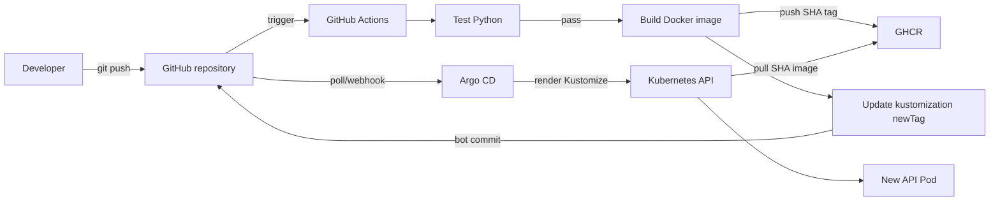

# CI/CD và GitOps trong project Iris MLOps

Tài liệu này giải thích **ý tưởng phía sau các bước đã thực hiện**, không chỉ đưa ra lệnh để chạy. Ví dụ được lấy trực tiếp từ project hiện tại: FastAPI, MLflow, Docker, GHCR, Kubernetes, Kustomize, GitHub Actions và Argo CD.

## 1. Bài toán chúng ta đang giải quyết

Khi sửa `src/api.py`, ta muốn hệ thống tự động trả lời bốn câu hỏi:

1. Code mới có chạy đúng không?
2. Nếu đúng, làm sao đóng gói nó thành Docker image?
3. Cluster phải chạy chính xác image nào?
4. Ai đưa cấu hình mới đó vào Kubernetes và theo dõi việc triển khai?

Project hiện tại chia trách nhiệm như sau:

| Thành phần | Trách nhiệm |
|---|---|
| GitHub | Lưu source code và Kubernetes manifests |
| GitHub Actions | Chạy test, build image, push image và cập nhật manifest |
| GHCR | Lưu Docker image đã build |
| Kustomize | Tạo manifest cuối cùng với đúng repository và tag image |
| Argo CD | So sánh Git với cluster và đồng bộ cluster theo Git |
| Kubernetes | Chạy Pod, Service và thực hiện rolling update |

## 2. CI và CD là gì?

### 2.1 Continuous Integration — CI

CI là quá trình kiểm tra một thay đổi trước khi xem nó là phiên bản có thể phát hành.

Trong project này, CI gồm:

```text
checkout code
    → cài Python và dependency
    → chạy pytest
    → kiểm tra cú pháp Python
```

Nếu test thất bại, luồng dừng lại. Docker image không được phát hành.

Mục tiêu của CI không phải chứng minh phần mềm hoàn toàn không có lỗi. Nó tạo một “cổng chất lượng” có thể lặp lại cho mọi commit.

### 2.2 Continuous Delivery/Deployment — CD

Sau CI, ta cần đưa phiên bản đã kiểm tra tới môi trường chạy.

- **Continuous Delivery**: phiên bản luôn sẵn sàng để deploy, nhưng có thể cần con người phê duyệt.
- **Continuous Deployment**: phiên bản vượt qua kiểm tra sẽ tự động được deploy.

Project hiện tại gần với Continuous Deployment cho cluster lab vì Argo CD đang bật `automated`, `prune` và `selfHeal`.

### 2.3 CD truyền thống và GitOps CD

CD truyền thống thường để pipeline chạy trực tiếp:

```bash
kubectl set image ...
kubectl apply ...
```

Như vậy GitHub Actions phải giữ credential của cluster và trực tiếp thay đổi cluster.

Project này dùng mô hình **GitOps**:

```text
GitHub Actions chỉ cập nhật Git
              ↓
Argo CD trong cluster đọc Git
              ↓
Argo CD cập nhật Kubernetes
```

Git trở thành nguồn mô tả trạng thái mong muốn — thường gọi là **source of truth**.

## 3. Bức tranh tổng thể



Điểm quan trọng là có **hai đầu ra khác nhau**:

1. Docker image được lưu ở GHCR.
2. Phiên bản image Kubernetes cần chạy được lưu trong Git.

Chỉ push image lên GHCR chưa đủ. Kubernetes sẽ không tự đoán rằng có image mới.

## 4. Hai loại commit trong một lần release

Giả sử bạn push commit source code:

```text
d264d9f Release API v1.1
```

GitHub Actions tạo image:

```text
ghcr.io/haixon231/iris-api:d264d9fe28e4b0d4596f9ee13bf55f32b650659a
```

Sau đó bot sửa `k8s/kustomization.yaml` và tạo một commit thứ hai, ví dụ:

```text
133090b chore: deploy d264d9fe... [skip ci]
```

Do đó:

- `d264d9f...` là commit chứa code được build.
- `133090b...` là commit ghi lại quyết định deploy image của commit trên.

Argo CD hiển thị revision `133090b...`, còn Deployment chạy image tag `d264d9f...`. Hai SHA khác nhau là đúng vì chúng đại diện cho hai commit có nhiệm vụ khác nhau.

## 5. Vì sao dùng SHA thay vì chỉ dùng `latest`?

Tag `latest` có thể trỏ sang nội dung mới theo thời gian. Nhìn manifest sau đây, ta không biết chính xác phiên bản nào đang chạy:

```yaml
image: ghcr.io/haixon231/iris-api:latest
```

Với SHA:

```yaml
image: ghcr.io/haixon231/iris-api:d264d9fe28e4b0d4596f9ee13bf55f32b650659a
```

ta có các lợi ích:

- Truy ngược image về đúng commit source code.
- Mỗi lần đổi SHA tạo ra thay đổi rõ ràng trong Git.
- Kubernetes nhận ra Pod template đã đổi và tạo rollout mới.
- Rollback bằng cách trả `newTag` về SHA cũ.
- Nhiều người nhìn cùng manifest sẽ hiểu cùng một trạng thái mong muốn.

Pipeline vẫn push thêm `latest` để thuận tiện thử nghiệm, nhưng deployment dùng SHA.

## 6. Đọc workflow hiện tại theo tư duy hệ thống

Workflow nằm tại `.github/workflows/pipeline.yaml`.

### 6.1 Trigger

```yaml
on:
  push:
    branches:
      - main
    paths-ignore:
      - "k8s/**"
      - "*.md"
      - "docs/**"

  pull_request:
    branches:
      - main
```

Ý nghĩa:

- Pull request vào `main`: chạy kiểm tra, không phát hành image.
- Push vào `main`: chạy kiểm tra và có thể build/push image.
- Chỉ sửa tài liệu hoặc `k8s/**`: không cần build lại ứng dụng.

### 6.2 Quyền mặc định

```yaml
permissions:
  contents: read
```

Workflow mặc định chỉ được đọc repository. Đây là nguyên tắc cấp quyền tối thiểu.

Job `build` cần thêm quyền:

```yaml
permissions:
  contents: write
  packages: write
```

- `packages: write`: push image lên GHCR.
- `contents: write`: push commit cập nhật `kustomization.yaml`.

`GITHUB_TOKEN` được GitHub tạo tự động cho từng job; không cần tự lưu password GitHub vào repository.

### 6.3 Chống hai release ghi đè nhau

```yaml
concurrency:
  group: mlops-pipeline-${{ github.ref }}
  cancel-in-progress: false
```

Các workflow trên cùng một branch được xếp theo nhóm. Không hủy workflow đang chạy giúp tránh tình huống một release đang cập nhật manifest thì release khác chen vào.

### 6.4 Job `test`

```yaml
test:
  runs-on: ubuntu-latest
```

GitHub tạo một máy ảo runner mới. Runner này không phải laptop và không phải node kind của bạn.

Các step thực hiện:

```yaml
- uses: actions/checkout@v4
- uses: actions/setup-python@v5
- run: python -m pip install -r requirements-dev.txt
- run: python -m pytest -q
- run: python -m compileall src
```

Mỗi workflow bắt đầu từ môi trường gần như sạch, nhờ đó test không vô tình phụ thuộc vào `.venv` hoặc file chỉ có trên laptop.

### 6.5 Quan hệ giữa `test` và `build`

```yaml
build:
  needs: test
```

`build` chỉ chạy sau khi `test` thành công.

```yaml
if: github.event_name == 'push' && github.ref == 'refs/heads/main'
```

Điều kiện này ngăn pull request push image. PR chỉ kiểm tra code; merge/push vào `main` mới phát hành.

### 6.6 Đăng nhập GHCR

```yaml
- uses: docker/login-action@v3
  with:
    registry: ghcr.io
    username: ${{ github.actor }}
    password: ${{ secrets.GITHUB_TOKEN }}
```

Đây là đăng nhập từ runner GitHub Actions vào GitHub Container Registry, không liên quan tới Docker login trên laptop.

### 6.7 Build và push hai tag

```yaml
tags: |
  ghcr.io/haixon231/iris-api:${{ github.sha }}
  ghcr.io/haixon231/iris-api:latest
```

Cùng một image có hai tên tham chiếu:

- SHA tag dành cho deploy chính xác và rollback.
- `latest` dành cho con người thử nhanh.

Tên GHCR phải viết thường, vì vậy dùng `haixon231`, không dùng `HaiXon231`.

### 6.8 Cập nhật trạng thái mong muốn

```bash
sed -i \
  "s|^    newTag:.*$|    newTag: ${GITHUB_SHA}|" \
  k8s/kustomization.yaml
```

Lệnh này thay:

```yaml
newTag: old-sha
```

thành:

```yaml
newTag: new-sha
```

Trong `k8s/api.yaml`, image cơ sở là:

```yaml
image: iris-api
```

Kustomize tìm đúng tên này và biến nó thành:

```yaml
image: ghcr.io/haixon231/iris-api:new-sha
```

`name` trong phần `images` phải khớp chính xác với tên image trong Deployment. `iris_api` và `iris-api` là hai chuỗi khác nhau.

### 6.9 Commit manifest

```bash
git add k8s/kustomization.yaml
git commit -m "chore: deploy ${GITHUB_SHA} [skip ci]"
git pull --rebase origin main
git push origin HEAD:main
```

Commit này rất quan trọng: nó biến việc deploy thành lịch sử có thể kiểm tra và rollback.

`git pull --rebase` giảm nguy cơ push thất bại nếu branch `main` vừa có commit mới. Nó không loại bỏ hoàn toàn mọi race condition; với hệ thống lớn nên tách repository cấu hình hoặc dùng pull request để cập nhật deployment.

Commit do `GITHUB_TOKEN` tạo thường không kích hoạt lại workflow `push`, giúp tránh vòng lặp vô hạn. Project còn có `paths-ignore: k8s/**` và `[skip ci]` như các lớp bảo vệ bổ sung.

## 7. Vai trò của Kustomize

`kubectl kustomize k8s` chỉ **render** YAML cuối cùng ra màn hình:

```bash
kubectl kustomize k8s
```

Nó không thay đổi cluster.

Nếu không dùng Argo CD, ta có thể apply bằng:

```bash
kubectl apply -k k8s
```

Khi dùng Argo CD, bình thường không cần chạy lệnh trên sau mỗi release. Argo CD render cùng thư mục `k8s` rồi apply cho ta.

## 8. Kubernetes triển khai image mới như thế nào?

Khi Argo CD đổi image trong Deployment:

```text
ReplicaSet cũ đang có 1 Pod Ready
            ↓
Kubernetes tạo ReplicaSet mới
            ↓
Pod mới pull image SHA từ GHCR
            ↓
readinessProbe /health thành công
            ↓
Service có thể gửi traffic tới Pod mới
            ↓
Pod cũ bị scale xuống
```

Đây là rolling update. Trong lúc Pod mới còn `ContainerCreating`, Pod cũ có thể vẫn chạy, nên `kubectl get deployment` vẫn hiển thị một replica available.

## 9. Cách hiểu các trạng thái vừa gặp

### `ErrImagePull`

Kubelet thử tải image nhưng thất bại. Ví dụ thực tế:

```text
ghcr.io/haixon231/iris-api:initial: not found
```

Nguyên nhân là manifest ban đầu dùng tag `initial`, nhưng GHCR không có tag đó.

### `ImagePullBackOff`

Sau khi pull thất bại, Kubernetes chờ lâu dần rồi thử lại. `BackOff` không phải nguyên nhân gốc; cần đọc event ngay trước nó.

### `ContainerCreating`

Pod đã được schedule và kubelet đang chuẩn bị container: pull/unpack image, tạo network, mount volume. Nếu event chỉ có `Pulling image`, chưa thể kết luận là lỗi.

### Argo CD `Synced` nhưng `Progressing`

- `Synced`: cấu hình trên cluster đã khớp manifest Git.
- `Progressing`: workload mới chưa đạt trạng thái khỏe, chẳng hạn Pod đang tải image.

Hai trạng thái đo hai thứ khác nhau nên có thể xuất hiện đồng thời.

## 10. Lệnh quan sát toàn bộ luồng

### Kiểm tra commit local và remote

```bash
git log --oneline --decorate -5
git pull --rebase origin main
```

Nếu GitHub Actions vừa tạo bot commit, file local chỉ cập nhật sau khi pull.

### Xem image mà Kustomize sẽ tạo

```bash
kubectl kustomize k8s | grep -n "image:"
```

### Xem image Deployment đang yêu cầu

```bash
kubectl get deployment iris-api \
  -n mlops-demo \
  -o jsonpath='{.spec.template.spec.containers[0].image}{"\n"}'
```

### Theo dõi rollout

```bash
kubectl rollout status deployment/iris-api \
  -n mlops-demo \
  --timeout=10m
```

### Theo dõi Pod

```bash
kubectl get pods -n mlops-demo -w
```

### Tìm nguyên nhân Pod lỗi

```bash
kubectl describe pod -n mlops-demo <pod-name>
kubectl logs -n mlops-demo <pod-name>
```

`describe` phù hợp với lỗi pull, schedule, mount và probe. `logs` phù hợp khi container đã khởi động nhưng ứng dụng bị lỗi.

## 11. Rollback đúng theo GitOps

Không nên sửa Deployment trực tiếp bằng `kubectl edit`, vì `selfHeal` có thể đưa nó trở lại trạng thái trong Git.

Cách rollback dễ hiểu nhất:

1. Tìm SHA image cũ từng chạy tốt.
2. Sửa `newTag` trong `k8s/kustomization.yaml` về SHA đó.
3. Commit và push.
4. Argo CD phát hiện commit và rollout image cũ.

Hoặc revert commit deployment:

```bash
git revert <deployment-commit>
git push origin main
```

## 12. Ranh giới trách nhiệm khi debug

| Triệu chứng | Kiểm tra đầu tiên | Thành phần có khả năng liên quan |
|---|---|---|
| `pytest` fail | GitHub Actions job `test` | Code/test/dependency |
| Build image fail | Step build logs | Dockerfile/build context |
| Push bị từ chối | Login và `packages: write` | GHCR/GitHub permissions |
| GHCR có image nhưng Git không đổi tag | Step update/commit manifest | GitHub Actions |
| Git đã đổi nhưng cluster chưa đổi | Argo Application sync | Argo CD/repository access |
| Deployment đúng SHA nhưng `ErrImagePull` | Pod events | Tag, visibility, imagePullSecret |
| Pod chạy nhưng không Ready | `logs`, readiness probe | Ứng dụng/MLflow/network |

## 13. Những điểm project lab còn có thể cải thiện

1. Nếu GHCR package private, tạo `imagePullSecret` cho namespace hoặc chuyển package sang public.
2. Thay `emptyDir` của MLflow bằng PersistentVolumeClaim; hiện tại dữ liệu mất khi Pod MLflow bị thay thế.
3. Thêm integration test cho API và MLflow, không chỉ test model training.
4. Dùng pull request cho commit deployment ở môi trường production để có bước phê duyệt.
5. Tách cấu hình `dev`, `staging`, `production` bằng Kustomize overlays.
6. Cân nhắc pin GitHub Actions bằng commit digest trong hệ thống yêu cầu bảo mật cao.

## 14. Bài tập để tự kiểm chứng

1. Sửa một response nhỏ trong API và push lên `main`.
2. Ghi lại SHA của commit source.
3. Quan sát job `test` và `build` trên GitHub Actions.
4. Kiểm tra GHCR có tag SHA vừa ghi hay chưa.
5. Tìm commit `chore: deploy ...` do bot tạo.
6. Pull lại repository local và xem `newTag`.
7. Quan sát Argo CD chuyển `OutOfSync → Synced`.
8. Quan sát Kubernetes giữ Pod cũ cho tới khi Pod mới Ready.
9. Thử rollback bằng một commit Git thay vì `kubectl edit`.

## 15. Tài liệu chính thức

- [GitHub Actions: dùng GITHUB_TOKEN](https://docs.github.com/en/actions/tutorials/authenticate-with-github_token)
- [GitHub Packages: publish package bằng GitHub Actions](https://docs.github.com/en/packages/managing-github-packages-using-github-actions-workflows/publishing-and-installing-a-package-with-github-actions)
- [Kubernetes: quản lý object bằng Kustomize](https://kubernetes.io/docs/tasks/manage-kubernetes-objects/kustomization/)
- [Argo CD: core concepts](https://argo-cd.readthedocs.io/en/stable/core_concepts/)

